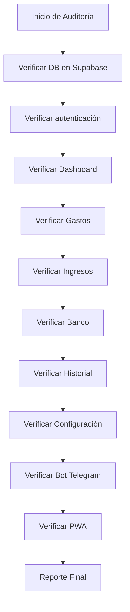

# 🔍 Auditoría de la Aplicación Finance PWA
> Parte de: [[projects/Vicky/docs/README]] · Relacionados: [[auditoria-completa]], [[auditoria-completa-2025]]

## Estado Actual del Proyecto

### ✅ Implementado y Funcional

1. **Autenticación**
   - Login con Supabase Auth
   - Logout funcional
   - Protección de rutas via middleware

2. **Base de Datos (Supabase)**
   - Tabla `accounts` (cuentas bancarias, billeteras, efectivo, deudas)
   - Tabla `transactions` (gastos, ingresos, transferencias)
   - Tabla `categories` (categorías padre e hijos)
   - Tabla `telegram_messages` (para el bot)
   - Tabla `telegram_users` (vinculación Telegram ↔ App)
   - RLS (Row Level Security) configurado
   - Categorías por defecto insertadas

3. **Backend Actions**
   - `lib/actions/accounts.ts` - CRUD completo de cuentas
   - `lib/actions/categories.ts` - CRUD completo de categorías
   - `lib/actions/transactions.ts` - CRUD completo de transacciones
   - `lib/auth/actions.ts` - Autenticación

4. **Páginas**
   - `/` - Dashboard principal (resumen de saldo, transacciones recientes, formulario de gastos)
   - `/gastos` - Manejo de gastos (categorización)
   - `/ingresos` - Cargar ingresos
   - `/banco` - Vencimientos e intereses
   - `/historial` - Historial de transacciones
   - `/configuracion` - Configuración general
   - `/configuracion/perfil` - Perfil de usuario
   - `/configuracion/apariencia` - Theme selector
   - `/configuracion/notificaciones` - Configuración de notificaciones
   - `/configuracion/seguridad` - Cambio de PIN
   - `/login` - Login de usuario

5. **Componentes UI**
   - GlassCard, Button, Input, Card
   - ExpenseFormCard (formulario de gastos)
   - IncomeForm (formulario de ingresos)
   - CategorizationModal (modal de categorización)
   - Sidebar (navegación)
   - ThemeSelector
   - AvatarSection
   - AddAccountForm

6. **Bot de Telegram**
   - Webhook configurado
   - Comandos: /start, /hoy, /saldos, /cancelar
   - whitelisting de usuarios (solo Ornella y Vickyta)
   - Integración con Supabase para transacciones

---

## ❌ Pendiente / Por Verificar / Necesita Mejoras

### 1. **Botón de Menú del Bot en Telegram**
   - No está configurado el botón de menú (BotMenuButton)
   - Los comandos están registrados pero el botón inferior no aparece

### 2. **Integración Telegram ↔ App**
   - No hay forma de vincular una cuenta de Telegram con la cuenta de la app
   - Debería haber un proceso de "link" para identificar al usuario

### 3. **Formulario de Gastos (ExpenseFormCard)**
   - Verificar que todos los campos funcionen correctamente
   - Verificar que guarde en Supabase
   - Verificar el flujo de cuotas

### 4. **Formulario de Ingresos (IncomeForm)**
   - Verificar que funcione correctamente
   - Verificar que guarde en Supabase

### 5. **Página Banco**
   - Ver qué funcionalidades tiene implementadas
   - Vencimientos de tarjetas
   - Intereses

### 6. **Historial**
   - Verificar que muestre las transacciones correctamente
   - Filtros funcionando

### 7. **Configuración**
   - Perfil (actualizar nombre, avatar)
   - Apariencia (temas)
   - Notificaciones
   - Seguridad (PIN)

### 8. **Cuentas (Accounts)**
   - CRUD completo pero verificar que funcione
   - Crear, editar, eliminar cuentas

### 9. **Mobile PWA**
   - Verificar manifest.json
   - Service worker para offline
   - Install prompt

---

## 📋 Plan de Auditoría y Mejoras

## 🎯 Prioridades

1. **Alta Prioridad**
   - [ ] Verificar que las transacciones se guardan correctamente
   - [ ] Verificar flujo completo de agregar gasto/ingreso
   - [ ] Verificar Bot Telegram responde correctamente

2. **Media Prioridad**
   - [ ] Página Banco - vencimientos
   - [ ] Historial con filtros
   - [ ] Vinculación Telegram ↔ App

3. **Baja Prioridad**
   - [ ] Mejoras UI/UX
   - [ ] Notificaciones push
   - [ ] PWA install prompt
